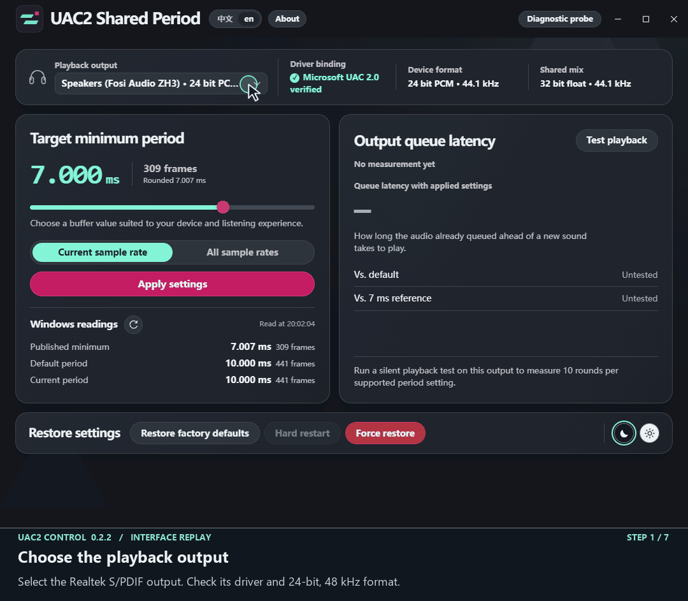
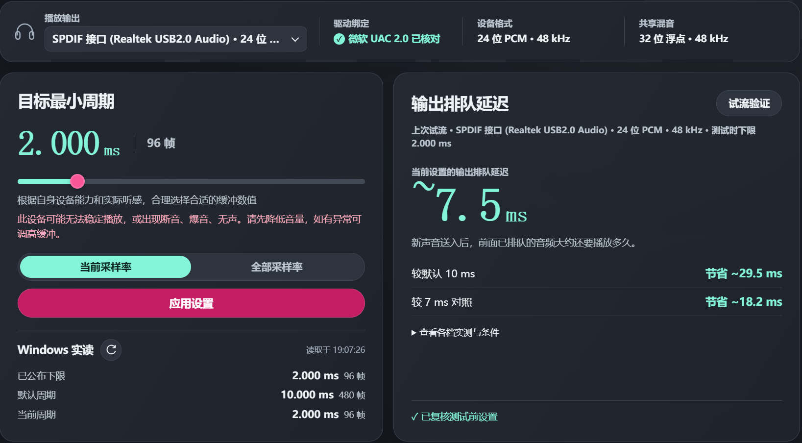
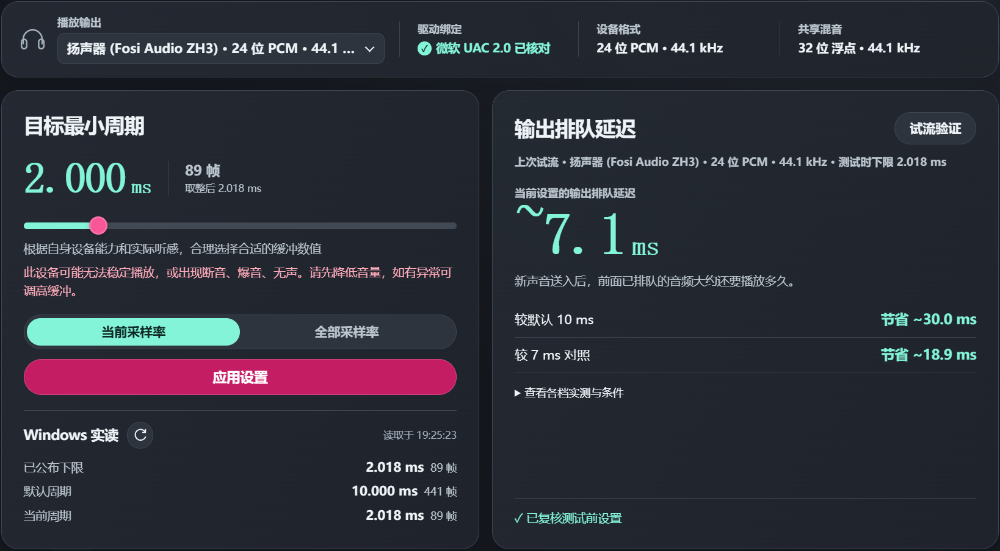

[简体中文](README.md) · **English**

# UAC2 Control · Lower-latency shared audio on Windows

**If your playback output uses the Microsoft USB Audio 2.0 driver, UAC2 Control can lower the minimum period an app can request while keeping the original default.** In WASAPI shared mode, Windows mixes audio from multiple apps and processes a batch of samples every engine period. If a rhythm game or player requests a shorter period, a new sound may have less audio queued ahead of it.

USB DAC dongles, motherboard audio devices connected internally over USB, and external DACs can all qualify. Select the output you listen to and look for **Microsoft UAC 2.0 verified** under **Driver binding**. Headphones and S/PDIF on the same card can be selected separately. Outputs using other drivers may show **Playback test only** if Windows can report their shared format and period range. This path has been tested with simulated devices and still needs a hardware result.

**Windows x64 · 0.2.2**　[Release ZIP (when published)](https://github.com/yosuzu/uac2-wasapi-shared-lowlatency/releases) · [Technical notes for maintainers](docs/TECHNICAL.en.md)

The 0.2.2 executable is unsigned. Windows may show an unknown publisher or SmartScreen warning after download. The SHA-256 of this release ZIP is `112E5744333674CA7F3D06C5AD6F4E9D389FF8F9695CFF4F6B8B42E3559D746C`. [Microsoft SmartScreen guidance](https://learn.microsoft.com/windows/apps/package-and-deploy/smartscreen-reputation)

## Select an output, apply a period, and check the result

The walkthrough uses the 0.2.2 interface to set Realtek S/PDIF to 2 ms. It replays hardware readings from the 24-bit, 48 kHz test in 0.1.2. The three screenshots further down come from a separate test with other audio playing in the background.

<picture>
  <source media="(prefers-reduced-motion: reduce)" srcset="docs/images/usage-en.png">
  
</picture>

1. **Launch.** Extract `UAC2-Control-0.2.2-windows-x64.zip` to a writable local folder and run `UAC2-Control.exe`. The main window uses the Microsoft Edge WebView2 Runtime and requests administrator privileges. The first launch explains the risk of interruptions and loud pops. Choosing **No, exit** leaves the prompt in place for the next launch. [WebView2 Runtime](https://developer.microsoft.com/microsoft-edge/webview2/)
2. **Apply a setting.** Select the output and check its driver, bit depth, and sample rate. Pause playback and turn down your amp or speakers before moving the slider. Choose **Current sample rate** or **All sample rates**, then click **Apply settings** and confirm. The first scope can cover several bit depths at that rate. The second covers common sample rates present on that output for the same channel count. Reloading the device may interrupt playback and recording across the card.
3. **Check Windows readings.** When the device returns, click the refresh arrow. **Published minimum** is the shortest period an app can request for this format. **Default period** is the period Windows uses when the app requests the default. **Current period** is what the engine was using at the instant it was queried. **A 2 ms minimum can coexist with a 10 ms current period** until an app successfully requests a shorter one. The window updates automatically when the bit depth or sample rate changes.
4. **To find out how much queue time changed, click Test playback.** Select your **osu! (lazer) installation folder** or its `current` subfolder. It must contain the 64-bit, Un4seen-signed `bass.dll` and `basswasapi.dll`. An unelevated helper opens the stream only after you click **Start test**. It sends zero-valued samples and preserves system volume, mute, and applied settings. Adjusting the minimum and refreshing Windows readings work without the game libraries.

**Why use the game's audio libraries?** When osu! (lazer) uses this Windows shared-output path, it passes its mix of music and hit sounds to BASSWASAPI. The test uses the same local BASS libraries to open a similar output stream on your selected device, feeding it silence in place of the game's mix. It estimates how much audio would have to play before a hit sound added to the queue at that instant. The test does not run a beatmap, process keypresses, or reproduce the game's mixing workload. [Audio output in the referenced game framework revision](https://github.com/ppy/osu-framework/blob/932a5529e34eb8a0f993d51f3c3d501faf921055/osu.Framework/Threading/AudioThread.cs#L207-L253)

The test compares the default period (or a 10 ms reference when applicable), a 7 ms reference, and the applied minimum. Each available setting gets 10 rounds. **Output queue latency** estimates how long the audio already ahead of a new sound will take to play. A tilde (`~`) marks an estimate. Settings that run at the same actual period are labelled **Same period**. If the stream cannot run at a requested setting, the results explain why. Measuring a keypress, the game's response, and the instant sound reaches the headphones would require a separate end-to-end test.

## Three outputs with other audio playing

All three screenshots came from one PC while another audio source was playing. Each output used 24-bit PCM with a 32-bit floating-point shared mix. The slider was set to **2 ms** and Windows retained its **10 ms** default. The last two columns show the estimated reduction in queue time in that run.

| Playback output and sample rate | Windows minimum and current period | Queue estimate | Saved vs. 10 ms default | Saved vs. 7 ms reference |
| --- | ---: | ---: | ---: | ---: |
| CX31993 USB DAC dongle · headphones · 44.1 kHz | 89 frames · 2.018 ms | ~7.4 ms | ~29.4 ms | ~18.1 ms |
| Onboard ALC4080 · Realtek USB2.0 Audio S/PDIF · 48 kHz | 96 frames · 2.000 ms | ~7.5 ms | ~29.5 ms | ~18.2 ms |
| Fosi Audio ZH3 · speakers endpoint · Microsoft UAC2 driver · 44.1 kHz | 89 frames · 2.018 ms | ~7.1 ms | ~30.0 ms | ~18.9 ms |

At 44.1 kHz, 2 ms is 88.2 frames. Rounding up to 89 gives 2.018 ms. In the ZH3 screenshot, **2.018 ms** is the engine period, **~7.1 ms** is the measured stream's estimated queue time, and **~30.0 ms** is the reduction from the default-period run. Other games, devices, and workloads need their own measurements.

View the three hardware screenshots

**CX31993 USB DAC dongle**

**Onboard ALC4080 S/PDIF output**

**Fosi Audio ZH3 using the Microsoft driver supplied with Windows**

A user also confirmed that the **CX31993 works on a separate Windows 10 PC** after retesting. All three screenshots above are from the local test PC. The evidence for the Windows 10 machine consists of an earlier diagnostic capture and the user's follow-up. The retest came without screenshots or step-by-step restore readings. [Windows 10 evidence and its scope](docs/TECHNICAL.en.md)

## Below 2 ms, game anti-cheat, and recovery

**Protect your hearing and equipment.** The slider runs from 0.5 to 10 ms in 0.1 ms steps. A very short period or a reconnect can cause dropouts or loud pops. At high volume a pop can damage your hearing, headphones, or speakers. Pause playback and lower your listening volume before applying or restoring settings. Turn it back up only after checking that playback sounds normal.

**Below 2 ms.** REAL is a separate audio tool that requests the shortest period available on the Windows default playback output. On the local test PC, it could not enable low-latency mode at the sub-2 ms settings the tester tried. The screenshot shows the error from REAL v0.2.0. It does not identify the output, the exact request, or the cause. The lowest stable setting depends on the device, format, and workload. Below 3 ms, UAC2 Control displays an additional warning about dropouts, pops, and loss of audio. If you hear a problem, turn the volume down, pause playback, and raise the period or restore your settings. [REAL error screenshot](docs/images/real-limit.png) · [REAL project](https://github.com/miniant-git/REAL)

**Game anti-cheat.** UAC2 Control changes the period record Windows stores for the selected audio output and asks Windows to reload the card. The optional test loads audio libraries in a separate helper. The tool does not inject code into games, modify their executables or audio libraries, automate player input, or change scores. This project is independent of the osu! team and has no official approval or anti-cheat compatibility testing. These implementation details cannot establish how a particular game or tournament will treat the tool. [osu! fair-play rules](https://osu.ppy.sh/wiki/en/Rules)

| Situation | Action |
| --- | --- |
| Undo this tool's changes | **Restore factory defaults** writes back the full snapshot saved **before this tool first changed this output**, across its sample rates. Any prior custom settings in that snapshot are restored too. |
| The setting was written but Windows has not picked it up | Check the card and USB port shown, then separately confirm **Hard restart**. Windows disconnects and reconnects that port once and the tool rereads the setting. You can cancel and retry later. |
| The snapshot is missing, damaged, or cannot be matched | The red **Force restore** action requires its own confirmation. Windows removes the verified USB audio function, keeps the driver package, and rediscovers the device. This affects the whole card. The endpoint ID, default output, or volume may change. Pause playback and lower the volume first, then check which output is active afterward. A native recovery window also offers this action if WebView2 cannot start. |

## Updates, feedback, and credits

To update in place, replace the EXE. When moving the tool, take the adjacent `uac2-data` folder with it. It contains the first recovery snapshots for this machine and the current account's consent and selected game folder. To report a problem, select the affected output and use **Diagnostic probe** at the top right to generate a report. Review `uac2-data/diagnostics/latest.json` and attach it manually to an issue with the card model, device format, target period, selected scope, and exact message. Only the report is needed. Keep private preferences and recovery snapshots on your PC. [Report an issue](https://github.com/yosuzu/uac2-wasapi-shared-lowlatency/issues/new)

The project is credited to **UAC2 Control Project**. **yosuzu** defined the requirements and tested the tool on hardware. **OpenAI Codex (GPT-6.2 Astra)** implemented the main code. The application is written in Rust and uses WebView2 for its interface. It reuses parts of ZH3 Control for endpoint discovery, Windows Plug and Play enumeration, and USB port reconnection. The projects are maintained separately. ZH3 Control targets the Fosi driver, while UAC2 Control targets the Microsoft USB Audio 2.0 driver. [ZH3 Control](https://github.com/yosuzu/zh3-wasapi-shared-lowlatency)

From 0.2.1, project-owned code, documentation, and original icons use **PolyForm Noncommercial 1.0.0**. Third-party components retain their own terms. To share the tool, send the release ZIP with its license and attribution intact. Users supply BASS and BASSWASAPI locally for the optional test. [License](LICENSE) · [Attribution and third-party notices](THIRD-PARTY-NOTICES.txt) · [BASS licensing](https://www.un4seen.com/bass.html#license)

If the tool works well for you, consider making a video showing how you use it, or sharing the project link on a forum or in a group chat so others looking to reduce audio latency can find it.

Thanks for reading. If this project helped you, consider giving it a star on GitHub.
