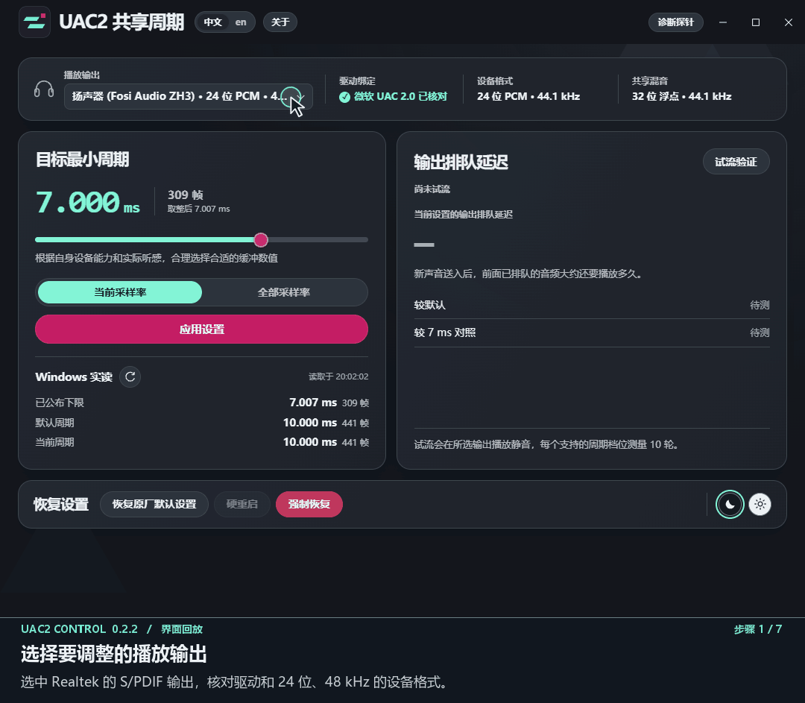
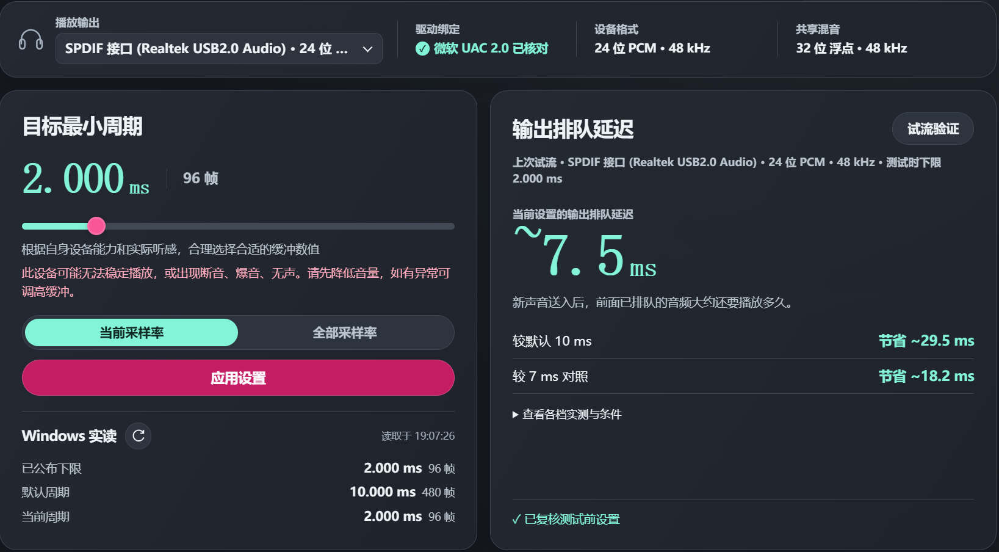
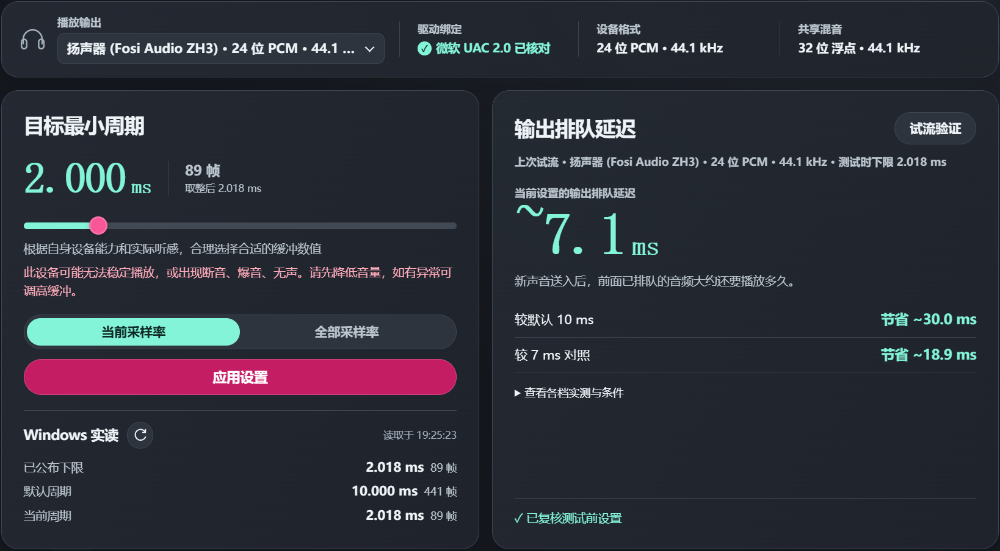

**简体中文** · [English](README.en.md)

# UAC2 Control · Windows 共享播放低延迟工具

**如果你的播放输出使用微软 USB Audio 2.0 驱动，UAC2 Control 可以调低应用能请求的最小播放周期，并保留原来的默认周期。** Windows 在共享模式（WASAPI Shared）下把多个应用的声音混在一起，每隔一个周期处理一批音频。对音游里的打击音来说，如果播放应用请求了更短的周期，新声音前面排着的音频可能更少，听到它之前就有机会少等一段时间。

USB 小尾巴、通过 USB 连接的主板板载声卡和外置解码器都可能适用。打开程序，选中你实际听声音的输出，看「驱动绑定」是否显示 **微软 UAC 2.0 已核对**。同一块声卡的耳机和 S/PDIF 数字输出可以分开选择。其他驱动的输出如果能读到完整的共享格式和周期，界面可提供「仅支持试流」；这条路径已有模拟测试，仍缺实机记录。

**Windows x64 · 0.2.2**　[发行 ZIP（发布后可下载）](https://github.com/yosuzu/uac2-wasapi-shared-lowlatency/releases) · [维护者技术文档](docs/TECHNICAL.md)

0.2.2 的 EXE 未签名，下载后 Windows 可能显示未知发布者或 SmartScreen 提示。此版 ZIP 的 SHA-256 为 `112E5744333674CA7F3D06C5AD6F4E9D389FF8F9695CFF4F6B8B42E3559D746C`。[Microsoft SmartScreen 说明](https://learn.microsoft.com/windows/apps/package-and-deploy/smartscreen-reputation)

## 从选输出到看结果

下面用 0.2.2 的界面演示如何给 Realtek S/PDIF 选择 2 ms 并验证。动图回放已有实机读数，试流结果取自 0.1.2 的 24 位／48 kHz 记录。后面三张声卡截图来自另一次后台有声音播放的实测。

<picture>
  <source media="(prefers-reduced-motion: reduce)" srcset="docs/images/usage-zh.png">
  
</picture>

1. **启动。** 将 `UAC2-Control-0.2.2-windows-x64.zip` 解压到本机可写文件夹，运行 `UAC2-Control.exe`。主窗口使用 Microsoft Edge WebView2 Runtime，并请求管理员权限。首次启动会说明中断和爆音风险。选「否」会退出，下次仍会提示。[WebView2 Runtime](https://developer.microsoft.com/microsoft-edge/webview2/)
2. **应用设置。** 选中输出，核对驱动、位深和采样率。先暂停播放、降低耳放或音箱音量，再调滑条，选「当前采样率」或「全部采样率」，点击「应用设置」并确认。前者可覆盖该采样率下已有的多个位深，后者涵盖这个输出在相同声道数下实际支持的常用采样率。设备重载可能中断同卡的播放和录音。
3. **看 Windows 实读。** 设备回来后点「Windows 实读」旁的刷新按钮。「已公布下限」是应用可以请求的最短周期，「默认周期」是由 Windows 选取默认值时所用的周期，「当前周期」是读取这一刻引擎实际用的值。**下限变成 2 ms 后，当前仍可能是 10 ms**，直到有应用成功请求更短的周期。换位深或采样率后，窗口会自动更新。
4. **想知道少等了多少，再点「试流验证」。** 手选 **osu!（lazer）安装目录**或其中的 `current` 文件夹。目录内需有 Un4seen 签名的 64 位 `bass.dll` 和 `basswasapi.dll`。只有再点「开始测试」，普通权限的助手才会开流。它发送全零音频，保留原有的系统音量、静音和已应用设置。调周期和刷新读数都无需游戏音频库。

**为什么用游戏自带的音频库？** 当 osu!（lazer）使用这条 Windows 共享输出路径时，游戏会把混好的音乐和打击音交给 BASSWASAPI。试流用同一套本地 BASS 音频库，在你选的声卡上打开类似的输出流，用静音样本代替游戏混音。它回答的是「假如此刻送入一个打击音，前面排着的声音还要播多久」。它没有运行谱面、处理按键或重现游戏的混音负载。[对应版本的游戏框架实现](https://github.com/ppy/osu-framework/blob/932a5529e34eb8a0f993d51f3c3d501faf921055/osu.Framework/Threading/AudioThread.cs#L207-L253)

试流会比较默认周期（适用时用 10 ms 对照）、7 ms 对照和已生效的下限，每个可测档跑 10 轮。**输出排队延迟**估算的是一个新声音排到队尾时，前面的音频还要播多久。结果里的 `~` 表示估算。实际周期相同会显示「同一周期」；无法按请求值开流的档位会说明原因。键盘上报、游戏处理输入、耳机实际出声的时刻均在测量范围之外。

## 三个输出在后台播放时的实测

同一台电脑，后台已有其他音源播放，三个输出的设备格式均为 24 位 PCM，共享混音均为 32 位浮点。滑条都设为 **2 ms**，Windows 默认周期都保留在 **10 ms**。表中最后两栏是这次试流估算的队列等待差值。

| 播放输出和采样率 | Windows 下限与当前周期 | 输出队列等待 | 较默认 10 ms 少等 | 较 7 ms 对照少等 |
| --- | ---: | ---: | ---: | ---: |
| CX31993 小尾巴 DAC · 耳机 · 44.1 kHz | 89 帧 · 2.018 ms | ~7.4 ms | ~29.4 ms | ~18.1 ms |
| 主板 ALC4080 · Realtek USB2.0 Audio 的 S/PDIF · 48 kHz | 96 帧 · 2.000 ms | ~7.5 ms | ~29.5 ms | ~18.2 ms |
| Fosi Audio ZH3 · 扬声器输出 · 微软 UAC2 驱动 · 44.1 kHz | 89 帧 · 2.018 ms | ~7.1 ms | ~30.0 ms | ~18.9 ms |

在 44.1 kHz 下，2 ms 等于 88.2 帧，取整到 89 帧就是 2.018 ms。以 ZH3 为例，图中的 **2.018 ms** 是引擎处理一批音频的周期，**~7.1 ms** 是试流的排队等待，**~30.0 ms** 是和默认档相比少等的时间。其他游戏、声卡或负载下的结果需要另测。

展开三张本机实测截图

**CX31993 小尾巴 DAC**

**主板 ALC4080 的 S/PDIF 输出**

**Fosi Audio ZH3，使用 Windows 自带的微软驱动**

另有一台 **Windows 10 电脑上的 CX31993 已由用户复测确认可用**。上表及三张截图全部来自本机。对于另一台 Win10，现有记录包含较早的诊断和此次使用反馈，复测没有附截图或逐项恢复读数。[Win10 样本与证据说明](docs/TECHNICAL.md)

## 低于 2 ms、反作弊与恢复

**先保护听力和设备。** 滑条允许 0.5–10 ms，每格 0.1 ms。设置过低或声卡重连都可能引起断音或爆音，高音量下可能损伤听力、耳机或音箱。暂停播放、降低实际收听音量后再应用或恢复，等确认正常出声再调回音量。

**低于 2 ms。** REAL 是另一款音频工具，会在 Windows 默认播放输出上请求设备公布的最短周期。测试者在本机尝试低于 2 ms 的设置时，REAL 无法启用低延迟模式。截图记录了 REAL v0.2.0 的报错，没有显示设备、具体请求值或原因。这个结果可用来选本机的起点，每块声卡能稳定播放到多少仍要看实际格式与负载。界面在低于 3 ms 时会提醒断音、爆音和无声风险。如果已经听到异常，请先降低音量、暂停播放，再调高周期或恢复设置。[REAL 报错截图](docs/images/real-limit.png) · [REAL 项目](https://github.com/miniant-git/REAL)

**与游戏反作弊的关系。** UAC2 Control 调整 Windows 为所选音频输出保存的周期记录，并请求 Windows 重载声卡。可选试流在独立助手中加载音频库。工具不向游戏注入代码、不修改游戏程序或音频库，也不代玩家输入或计分。本项目独立于 osu! 开发团队，未经其批准或反作弊兼容性验证。仅凭这些实现细节无法判断某款游戏或赛事会如何认定本工具。[osu! 公平游玩规则](https://osu.ppy.sh/wiki/en/Rules)

| 遇到的情况 | 可以怎么做 |
| --- | --- |
| 想撤销本工具的调整 | 点「恢复原厂默认设置」。它写回**首次修改此输出前**保存的整份快照，包含该输出的各采样率。如果当时已有自定义设置，也会一并还原。 |
| 提示设置已写入，但 Windows 尚未采用 | 核对界面显示的声卡和 USB 端口，再单独确认「硬重启」。它让这个端口断开并重连一次，随后重新读取设置。取消可稍后重试。 |
| 快照丢失、损坏或无法匹配 | 红色「强制恢复」会单独确认，由 Windows 卸载已核对的 USB 音频功能、保留驱动包并重新识别。整块声卡会受影响，端点 ID、默认输出或音量可能变化。操作前暂停播放并降低音量，回来后核对实际输出。WebView2 无法启动时，原生应急窗口也可进入这项恢复。 |

## 更新、反馈与署名

更新时在原目录替换 EXE。移动程序时请一并保留同级 `uac2-data`，其中有本机设备首次修改前的恢复快照，以及当前账户的风险同意和游戏目录。遇到问题，选中出问题的输出，打开右上角「诊断探针」生成报告。先查看 `uac2-data/diagnostics/latest.json`，再手动附到 Issue，并注明声卡型号、设备格式、目标周期、修改范围和界面提示。只需附这份报告，私人偏好与恢复快照留在本机。[反馈问题](https://github.com/yosuzu/uac2-wasapi-shared-lowlatency/issues/new)

项目署名 **UAC2 Control Project**，主要代码由 **OpenAI Codex（GPT-6.2 Astra）** 实现。程序使用 Rust，界面由 WebView2 显示。端点探测、Windows 即插即用设备枚举和 USB 端口重连沿用了 ZH3 Control 的部分代码。两款工具各自维护，ZH3 Control 面向 Fosi 厂商驱动，本工具面向微软 USB Audio 2.0 驱动。[ZH3 Control](https://github.com/yosuzu/zh3-wasapi-shared-lowlatency)

自 0.2.1 起，项目自有代码、说明及原创图标采用 **PolyForm Noncommercial 1.0.0**，第三方组件按各自条款使用。转发给朋友时，可直接发送包含许可与署名的发行 ZIP。试流所需的 BASS 与 BASSWASAPI 由用户在本机提供。[许可全文](LICENSE) · [署名及第三方声明](THIRD-PARTY-NOTICES.txt) · [BASS 使用许可](https://www.un4seen.com/bass.html#license)

如果你觉得这个工具好用，欢迎录一段使用演示，或把项目链接分享到论坛、聊天群，让同样想改善音频延迟的人也能找到它。

感谢你看到这里，这个项目如果对你有帮助的话，欢迎点个star。
